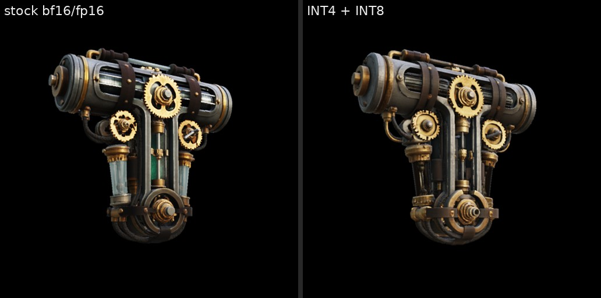
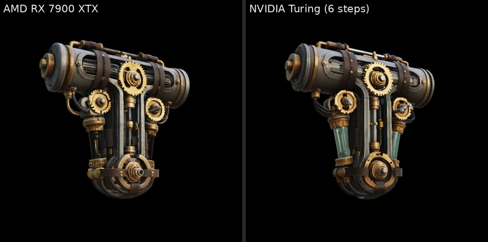
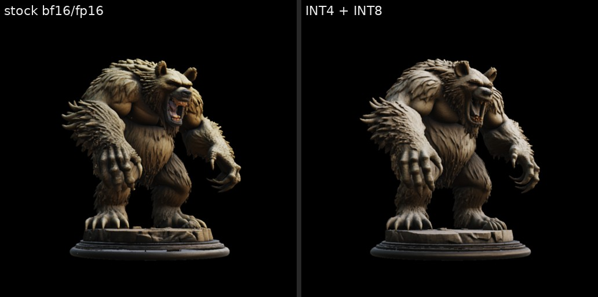

# TRELLIS.2-ROCm-INT4

Image to 3D with [TRELLIS.2](https://github.com/microsoft/TRELLIS.2) on AMD (ROCm) and NVIDIA (CUDA) GPUs, using
calibrated **INT4 flow DiTs**, **INT8 latent decoders** and an **INT8 DINOv3 image encoder**, with the last block of
the shape and texture DiTs replaced by a linear bridge (RoundBit, block-wise AutoRound-style calibration). The
repository is self-contained: it includes the TRELLIS.2 code (with low-VRAM loading) and the INT runtime. Only the
model weights are downloaded, from Hugging Face.

Developed and measured on an AMD RX 7900 XTX. The NVIDIA path follows microsoft/TRELLIS.2's own CUDA setup and uses the
same code (the INT4 kernels are Triton, which runs on both). Tested from a fresh clone on an RX 7900 XTX (ROCm 7.14,
PyTorch 2.14 rocm7.2 wheels) and on an NVIDIA Turing GPU (sm_75, CUDA 12.8, PyTorch 2.11 cu128).

## Examples

512 pipeline, seed 42, front view of the generated GLB. Inputs: [T.png](assets/example_image/T.png),
[bear](assets/example_image/5c80e5e03a3b60b6f03eaf555ba1dafc0e4230c472d7e8c8e2c5ca0a0dfcef10.webp).

```bash
./generate.sh --image assets/example_image/T.png            # right
./generate.sh --image assets/example_image/T.png --stock    # left
```





```bash
./generate.sh --image assets/example_image/5c80e5e03a3b60b6f03eaf555ba1dafc0e4230c472d7e8c8e2c5ca0a0dfcef10.webp
```



Interactive 3D (geometry only, opens in GitHub's STL viewer): [stock](assets/readme/bear_stock.stl) ·
[INT4 + INT8](assets/readme/bear_int4.stl)

The NVIDIA run (Turing, fp16 DiTs, SDPA) used `--sampler '{"ss":{"steps":6},"shape":{"steps":6},"tex":{"steps":6}}'`
instead of the default 12 steps.

## Results (RX 7900 XTX, seed 42, T.png / bear / gear example images)

| | weights the pipeline loads | peak VRAM | quality |
|---|---|---|---|
| 512, stock (bf16 DiTs, fp16 decoders, fp32 image encoder) | 11.0 GB | 2.72 GiB (T) | reference |
| 512, INT4 DiTs + INT8 decoders (model set before 2026-11-26) | 4.4 GB | 2.02 GiB (T), 1.96 (bear), 1.25 (gear) | see [Examples](#examples) |
| **512, + bridges + INT8 image encoder (default with the current model set)** | **3.4 GB** | **2.03 GiB** (T), 1.96 (bear), 1.13 (gear) | same geometry as the row above on T, bear and gear (full-resolution views against the source images); colours shift slightly |
| 1024_cascade, stock | – | 7.19 GiB (T), 6.85 (bear), 5.14 (gear) | reference |
| 1024_cascade, INT4 + INT8 decoders | – | 6.26 GiB (T), 6.34 (bear), 2.39 (gear) | geometry on par; T loses the teal glass cylinder (dark metal tube instead) |
| 1024_cascade with the current model set | – | not measured | not checked yet: the shape-512 bridge and the INT8 image encoder also run in the cascade |

The INT4 DiTs change the sample a little (a 3D generator turns small weight changes into a slightly different
object); the INT8 decoders are practically lossless (identical renders to the INT4-DiT run without them).
Known loss: on T the glass cylinder comes out as dark metal (512 and 1024). Judge results on full-resolution views
against the source image; chamfer distance (~0.004) does not show missing or invented parts.

## Setup

Linux, [uv](https://docs.astral.sh/uv/), `git`, `libjpeg-dev`, and for your GPU:

- **AMD:** ROCm with HIPIFY (tested: ROCm 7.14, RX 7900 XTX). `setup.sh` installs the PyTorch wheels for the ROCm
  major version it finds in `$ROCM_PATH/.info/version` (ROCm 7: `rocm7.2`, otherwise `rocm6.4`; override with
  `TORCH_INDEX_URL`). Set the GPU architecture first:
  ```bash
  export ROCM_PATH=/opt/rocm
  export HSA_OVERRIDE_GFX_VERSION=11.0.0   # RX 7900 XTX
  export TARGET_GFX=gfx1100
  export PYTORCH_ROCM_ARCH=gfx1100
  ```
- **NVIDIA:** a CUDA Toolkit (`nvcc`) whose major version matches the PyTorch wheel (default: CUDA 12.8 wheels;
  pick another with `TORCH_INDEX_URL`, e.g. `https://download.pytorch.org/whl/cu124`). With several toolkits
  installed, set `CUDA_HOME`. `nvcc` refuses host compilers newer than it supports (CUDA 12.8: GCC 13 at most); with a
  newer system GCC point it at an older one:
  ```bash
  export CC=gcc-13 CXX=g++-13 NVCC_PREPEND_FLAGS="-ccbin /usr/bin/g++-13"
  ```
  GPUs before Ampere (compute capability < 8.0, e.g. Turing) work without extra packages: `setup.sh` skips
  flash-attn (it has no kernels for them), `run.sh` selects PyTorch SDPA attention, and the bf16 flow DiTs run in
  fp16 (no bf16 hardware there).

Build the extensions with GCC (the default `CC`/`CXX`); `o-voxel` does not compile with clang.

```bash
./setup.sh            # detects the platform (nvidia-smi / rocminfo); force with --cuda or --rocm
```

`setup.sh` creates `.venv` (Python 3.11, PyTorch, Triton, flash-attn where it is usable) and builds the native
extensions nvdiffrast, nvdiffrec, CuMesh, FlexGEMM and `o-voxel/` (from this repo). On NVIDIA they build unchanged; on
AMD they are converted with hipify and patched (nvdiffrast-hip with the RDNA3 rasterizer fixes in `patches/`). It
downloads those sources while it runs; afterwards nothing besides the models is fetched.

Attention backend: PyTorch SDPA on AMD (flash-attn 2.8.3's Triton kernels do not load with the Triton of PyTorch
2.14) and on NVIDIA GPUs before Ampere, flash-attn on newer NVIDIA GPUs. `ATTN_BACKEND=sdpa|flash_attn|xformers`
overrides it.

First run on a new GPU: FlexGEMM benchmarks its sparse-convolution kernels for every new layer shape and caches the
winners in `~/.flex_gemm/autotune_cache.json`. On a fast GPU that is part of the warm-up; on a slow one the first
generation can take much longer than later ones.

Models (downloaded on first use into the Hugging Face cache):

- the INT files from the model repo in `RB_MODEL_REPO` (default `JustAnotherUser1/TRELLIS.2-ROCm-INT4`)
- `microsoft/TRELLIS.2-4B`: the INT files replace only the quantized linear layers; norms, embeddings and the
  sparse-structure decoder come from the original checkpoints
- the DINOv3 encoder (`facebook/dinov3-vitl16-pretrain-lvd1689m`) and RMBG-2.0 are gated: accept their licences
  on Hugging Face and log in (`hf auth login`). With `image_cond_model.int8.pt` in the model set only DINOv3's
  `config.json` is downloaded, not its 1.2 GB weights. Without access to RMBG-2.0 the background removal falls back
  to `transparent-background`.

| INT file | used by | size |
|---|---|---|
| `sparse_structure_flow_model.pt` | 512, 1024_cascade | 678 MB |
| `shape_slat_flow_model_512.pt` | 512, 1024_cascade | 656 MB (block 29 removed, see `bridges.pt`; older sets: 678 MB) |
| `tex_slat_flow_model_512.pt` | 512 | 656 MB (block 29 removed; older sets: 678 MB) |
| `shape_slat_flow_model_1024.pt` | 1024_cascade | 678 MB |
| `tex_slat_flow_model_1024.pt` | 1024_cascade | 678 MB |
| `shape_slat_decoder.int8.pt`, `tex_slat_decoder.int8.pt` | both | 482 MB each |
| `bridges.pt` | 512, 1024_cascade | 19 MB: linear bridges for block 29 of the shape / texture 512 DiTs |
| `image_cond_model.int8.pt` | both | 309 MB: DINOv3 ViT-L, bf16 + INT8 linears (stock: 1213 MB fp32) |

Only the files the chosen pipeline needs are downloaded. `--models_dir DIR` reads them from a local folder instead.
`bridges.pt` and `image_cond_model.int8.pt` are used when the model set has them; model sets without them (full
678 MB DiT files) still load as before. DiT files with a removed block refuse to load without `bridges.pt`.
On GPUs without native bf16 (NVIDIA before Ampere) the INT8 image encoder is skipped and the fp32 one is used,
because fp16 overflows inside DINOv3 (`--cond int8` forces it, bf16 then runs emulated).

## Usage

```bash
./generate.sh --image photo.png                          # 512 pipeline -> outputs/photo_s42.glb + .png preview
./generate.sh --image photo.png --pipeline 1024_cascade  # higher resolution, more VRAM
./generate.sh --image photo.png --stock                  # unmodified bf16 / fp16 models, as a reference
```

Output: `outputs/<image>[_<pipeline>]_s<seed>.glb` (textured PBR mesh) and a 2x2 render grid `.png`
(shaded / normals, PBR channels). Example inputs are in `assets/example_image/`. A run prints, for example:

```
{"generate_s": 13.8, "peak_vram_gib": 1.13, "int_layers": {"image_cond_model": "int8", "sparse_structure_flow_model": 210, "shape_slat_flow_model_512:bridged_blocks": 1, "shape_slat_flow_model_512": 203, "tex_slat_flow_model_512:bridged_blocks": 1, "tex_slat_flow_model_512": 203, "shape_slat_decoder": 104, "tex_slat_decoder": 104}}
preview: outputs/gear_clean_s42.png
model: outputs/gear_clean_s42.glb
```

`int_layers` lists the INT layers swapped into each model (`:bridged_blocks` = blocks replaced by a bridge,
`image_cond_model` = the INT8 DINOv3); an empty `{}` means the stock models ran.

Options: `--seed`, `--out DIR`, `--symmetry off|auto|x|xy...` (enforce mirror symmetry, z up),
`--sampler` (JSON per stage, e.g. `{"shape": {"steps": 24}}`), `--fp16_decoders`, `--no_bridges` (only for model sets
whose DiT files still contain the bridged block), `--cond auto|int8|fp32` (image encoder), `--faces` / `--texture_size`
(GLB), `--no_preview`, `--no_warmup` (skip the 1-step warm-up run that also autotunes the kernels).

The GLB export (remeshing + xatlas UV unwrap on the CPU) takes several minutes at the default `--faces 1000000
--texture_size 4096`; `--faces 200000 --texture_size 2048` writes the gear in about a minute.

Environment: `RB_MEM` host-RAM cap (default 13G, applied through `systemd-run` when available; the low-VRAM
pipeline keeps models in host RAM), `TRELLIS_MODEL_CACHE_GB` (models kept in RAM, default 5),
`TRELLIS_REMBG=auto|transparent_background|birefnet`, `ROUNDBIT_INT4_KERNEL=0` (no Triton INT4 kernels),
`TRELLIS_PYTHON` (interpreter, default `.venv/bin/python`), `TRELLIS_PLATFORM=cuda|rocm` (default: what `setup.sh`
built for), `ATTN_BACKEND=sdpa|flash_attn|xformers` (see Setup), `TRELLIS_DIT_DTYPE=float16|bfloat16` (flow DiT
precision; default bf16, fp16 on GPUs without native bf16).

## Layout

```
generate.sh / generate.py   image -> GLB (+ preview) with the INT models; generate.sh adds the RAM cap
run.sh                      runs a script in .venv with the platform's environment settings
setup.sh                    builds .venv and the native extensions (CUDA or ROCm)
roundbit/                   INT runtime: Int4Linear + Triton INT4 kernels, INT8 decoder layers, block bridges,
                            INT8 DINOv3 loader
trellis2/                   TRELLIS.2 inference code (lazy / meta-device model loading, symmetry)
o-voxel/                    TRELLIS.2 voxel / mesh extension (built by setup.sh), GLB export
patches/                    nvdiffrast-hip fixes applied by setup.sh
assets/                     example images, HDRI for the preview renders
```

`trellis2/`, `o-voxel/` and the ROCm part of `setup.sh` come from [TRELLIS.2-ROCm](https://github.com/Mateusz-Dera/TRELLIS.2-ROCm)
(commit `aa1528a`) with the low-VRAM, meta-device loading (`trellis2.models.META_HOOKS`: quantized layers are
swapped in before the original weights are allocated), transformers 5, rembg-fallback and symmetry changes;
training code, datasets and the texturing pipeline are left out. `o-voxel/` is identical to microsoft/TRELLIS.2's; the
CUDA part of `setup.sh` follows microsoft/TRELLIS.2's setup.

## Licence

TRELLIS.2 and TRELLIS.2-ROCm are MIT (`LICENSE-TRELLIS.2`). The RoundBit layer code in `roundbit/` builds on
LittleBit (CC BY-NC 4.0): private, non-commercial use. The model weights follow the licences of
`microsoft/TRELLIS.2-4B` and the encoders it uses.
